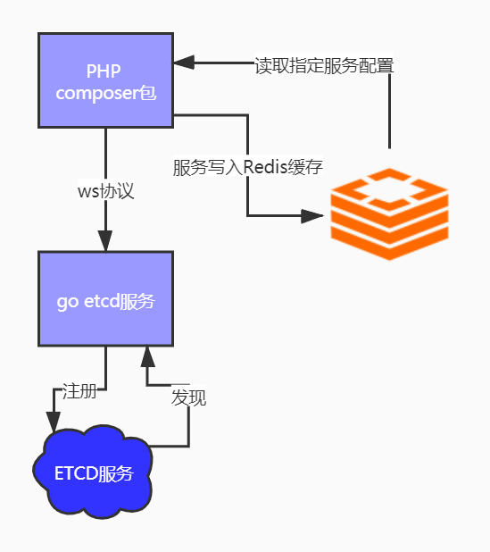

# php-etcd-discovery

[](https://secure.php.net/)
[](https://github.com/walkor/Workerman)
[](https://github.com/cgpipline/strack/blob/master/LICENSE)


PHP版本，基于Workerman的ETCD服务注册和发现

- 支持http服务
- 支持 text 协议的 rpc 服务（测试）
- 自带熔断器
- 支持 K8S service ip 自动获取，非K8S环境自动获取本地ip

# 架构



# 安装

```
composer require teamones/etcd-discovery
```

# 版本兼容

| 版本 | PHP | Workerman | illuminate/redis | 说明 |
| --- | --- | --- | --- | --- |
| 3.x | >= 8.1 | ^5.1 | ^10.0 \|\| ^11.0 \|\| ^12.0 | 适配 webman 2.x / PHP 8.5 |
| 2.x | >= 7.4 | ^4.0.4 | ~8.20 | 兼容 webman 1.x，后续只做缺陷修复 |

从 2.x 升级到 3.x 的变更点：

- 不再支持 PHP 7.4 / 8.0，最低 PHP 8.1；Workerman 最低 5.1。
- `illuminate/redis` 主版本从 8 提升到 10/11/12。`Illuminate\Redis\RedisManager` 的构造签名（`$app, $driver, $config`）与 `Connections\Connection` 的魔术调用在 10–12 中保持不变，因此 `teamones\cache\Client` 与 `teamones\breaker\RedisAdapter` 的调用方式无需改动。
- 内部所用 Workerman API（`AsyncTcpConnection` 的 `connect/reconnect/cancelReconnect/getStatus`、`Timer::add/del`、`onMessage/onError/onClose/onWebSocketConnect`）在 5.1+ 中均保留，协程模式为可选能力，本组件按非协程方式运行。
- 配置项与 `config-example.php` 未变更，2.x 的 `config/etcd.php` 可直接沿用。

# 配合 webman 框架使用说明

## etcd 配置文件

**.env 增加**
```dotenv
# 当前服务注册到etcd名称
belong_system='project'

# etcd服务地址
etcd_host=10.168.30.25:2379

# webman 服务端口
host_port=8080
```

**/config/etcd.php配置**

```php
<?php
return [
    'discovery' => [
        'etcd_host' => env("etcd_host", ''),
        'server_name' => env("belong_system", ''),
        'server_uuid' => \Webpatser\Uuid\Uuid::generate()->string,
        'server_port' => env("host_port", 8080),
        'discovery_name' => ['im', 'saas', 'log', 'media'], // 要发现的服务名
        'legacy_cache_write' => false, // 全量升级默认关闭；仅在旧新 Worker 共存时临时开启。
        'cache_ttl' => 5, // 每个被发现服务独立缓存的有效期（秒）
        'request_timeout' => 5000, // HTTP 总超时（毫秒）
        'connect_timeout' => 500, // HTTP 连接超时（毫秒）
        'log' => runtime_path() . '/logs/etcd.log',
        'cache' => runtime_path() . '/logs'
    ]
];
```

## etcd-go 服务进程 随着 start.php 启动

**在start.php 增加以下代码**

```php
// Worker::$onMasterReload = function () 上面增加

// 拉起etcd服务
if (class_exists('teamones\process\EtcdGoServer')) {
    \teamones\process\EtcdGoServer::exec();

    // Workerman 关闭杀死 etcd服务
    worker::$onMasterStop = function () {
        \teamones\process\EtcdGoServer::kill();
    };
}
```

## 注册 etcd process worker 进程

**在 /config/process.php中增加**

```php
// etcd 对象
    'etcd' => [
        'handler' => teamones\process\Etcd::class,
        'count' => 1
    ],
```

## 基于 http 协议 curl 服务调用

**默认使用http协议**

```php
<?php

use teamones\Request;

$data = Request::connection()
            ->setHeader([
                'X-Userinfo' => request()->getXUserInfo(), // 一般需要传递用户信息
            ])
            ->setServerHost('im') // 请求服务名
            ->setRoute('options/get_business_mode') // 路由地址
            ->setMethod('POST') // 请求方式
            ->request();
```
